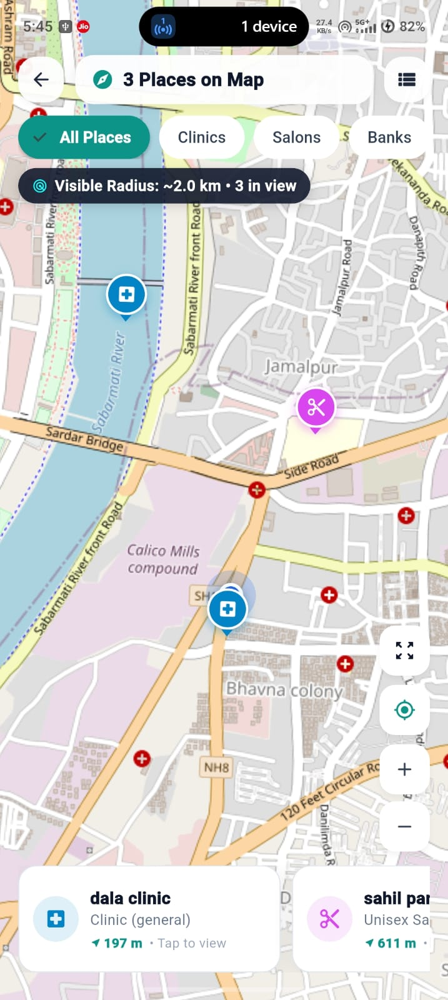
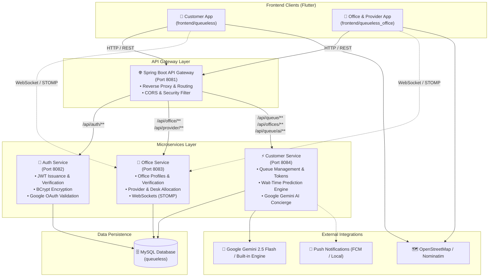

# ⚡ QueueLess

<p align="center">
  
  &nbsp;&nbsp;&nbsp;&nbsp;&nbsp;&nbsp;&nbsp;&nbsp;
  
</p>

<h3 align="center">Next-Generation Smart Queue Management, Real-Time Navigation & AI-Powered Virtual Concierge</h3>

<p align="center">
  QueueLess transforms frustrating physical queues into a seamless, synchronized digital experience. Built with a scalable <b>Spring Boot Microservices</b> backend and cross-platform <b>Flutter</b> applications for Customers, Service Providers, and Office Administrators.
</p>

<p align="center">
  
  
  
  
  
  
  
  
</p>

---

## 📌 Table of Contents

- [Overview & Problem Statement](#-overview--problem-statement)
- [Application Screenshots](#-application-screenshots)
- [Key Features by User Role](#-key-features-by-user-role)
  - [1. Customer Mobile App](#1--customer-mobile-app)
  - [2. Provider Portal (Desk Counter)](#2--provider-portal-desk-counter)
  - [3. Office Administration Hub](#3--office-administration-hub)
- [System Architecture](#-system-architecture)
- [Microservices Ecosystem](#-microservices-ecosystem)
- [Technology Stack](#-technology-stack)
- [Token Lifecycle & Queue Flow](#-token-lifecycle--queue-flow)
- [Project Structure](#-project-structure)
- [Getting Started & Local Setup](#-getting-started--local-setup)
- [API Gateway Routes](#-api-gateway-routes)
- [Future Roadmap](#-future-roadmap)

---

## 📖 Overview & Problem Statement

### The Problem
Traditional waiting lines in hospitals, clinics, banks, salons, and public offices waste countless productive hours:
* **Overcrowded Waiting Areas:** Creating health risks, stress, and poor customer satisfaction.
* **Uncertain Wait Times:** Customers are pinned to waiting rooms without knowing when they will be called.
* **Staff Bottlenecks:** Desk providers struggle to balance manual paperwork, queue order, and absent patrons.
* **Inefficient Office Oversight:** Office managers lack real-time visibility into desk efficiency, waiting counts, and service statistics.

### The QueueLess Solution
**QueueLess** bridges physical spaces and digital convenience. Customers can:
1. Discover nearby offices and view live waiting counts before leaving home.
2. Book virtual tokens remotely or scan on-site QR stand codes.
3. Track their queue position in real time with audio turn alerts (`"It's your turn!"`).
4. Consult an integrated **AI Concierge** powered by Google Gemini to ask questions like *"Do I have time for lunch?"* or *"What is the fastest clinic near me?"*.
5. Providers operate a focused, single-tap desk counter with automated customer calling, service tracking, and a fair late-arrival swap mechanism.

---

## 📱 Application Screenshots

<div align="center">

### Customer Experience

| Customer Dashboard | Office Discovery & Queues | Interactive Map & Navigation |
| :---: | :---: | :---: |
|  |  |  |
| *Personalized home, quick actions, active token pass & AI concierge* | *Real-time waiting count, distances, categories & status* | *OpenStreetMap pins, radar radius chip & quick card preview* |

<br />

### Intelligence & Office Administration

| AI Queue Concierge | Office Management & Operations |
| :---: | :---: |
|  |  |
| *Conversational AI: wait predictions, lunch break advisor & triage* | *Live queue overview, serving token, verified badge & desk counters* |

</div>

---

## 🚀 Key Features by User Role

### 1. 📱 Customer Mobile App
* **Digital Token Pass:** Generate instant queue tokens with clear numbering (e.g., `A-001`, `B-004`) from anywhere.
* **On-Site QR Check-in:** Scan the office's physical desk QR stand to instantly check in and secure a spot in line.
* **Real-Time Queue Tracking:** Live countdown of people ahead, estimated wait time, and dynamic status updates (`WAITING`, `CALLED`, `IN_SERVICE`).
* **Audio Turn Notifications:** High-fidelity voice alerts notify customers when their turn is near and when their token is called.
* **In-App AI Concierge (Gemini & Rule Engine):** Ask natural-language questions about queue pace, lunch break feasibility, fastest nearby offices, or priority queue assistance.
* **Interactive OpenStreetMap Geolocation:** Explore clinics, salons, and offices on an interactive map with radar radius filtering and GPS distance calculation.
* **Searchable & Filterable Token History:** Search previous visits by office name or token number, and filter records by date range and completion status (`COMPLETED`, `CANCELLED`, `SKIPPED`).
* **Priority Queue Triage:** Submit urgent priority requests for emergency or special-needs assistance.

### 2. 🩺 Provider Portal (Desk Counter)
* **Single-Tap Desk Operations:** Minimalist, distraction-free desk interface tailored for fast-paced service providers.
* **On-Duty / Off-Duty Toggle:** Instantly notify the office and customers when a provider is available or on break via real-time WebSockets.
* **Queue Action Controls:**
  * **Call Next:** Summons the next waiting token and triggers automated customer notification.
  * **Start Service:** Marks customer as actively in service at the provider's counter.
  * **Complete Service:** Closes the current token and recalculates remaining wait times.
  * **Skip / Late Swap:** Automatically moves an absent customer back by a configurable swap limit without losing their position entirely.
* **Provider Token History:** Filterable and searchable record of all tokens completed by the specific provider with date and status filters.

### 3. 🏢 Office Administration Hub
* **Organization Profile & Verification:** Manage business details, operating hours, category (Clinic, Salon, Bank, etc.), and map coordinates.
* **Desk & Provider Management:** Add, edit, and assign service providers to designated counter numbers (Desk #1, Desk #2, etc.).
* **Printable Desk QR Stand:** Generates office and desk-specific QR codes ready for printing and mounting on counter stands.
* **Live Queue Oversight:** Monitor serving tokens, total customers served, average wait time, and current queue length across all desks.
* **Office-Wide Historical Analytics:** Comprehensive token audit log across all providers with debounced search, provider filters, date filtering, and server-side pagination.

---

## 🏗 System Architecture

QueueLess is designed as a modular, resilient microservices architecture orchestrated through a unified API Gateway.



---

## 🧩 Microservices Ecosystem

| Service | Port | Primary Responsibilities |
| :--- | :---: | :--- |
| **`api-gateway`** | `8081` | Centralized reverse proxy forwarding incoming HTTP traffic to downstream microservices, handling CORS, header normalization, and routing. |
| **`auth-service`** | `8082` | Authentication, JWT token lifecycle, password hashing (BCrypt), Google OAuth token verification, and role-based permissions (`ROLE_CUSTOMER`, `ROLE_OFFICE`, `ROLE_PROVIDER`, `ROLE_ADMIN`). |
| **`office-service`** | `8083` | Office profile creation, KYC verification, operating hours, desk allocation, provider management, and WebSocket-based on-duty broadcasting. |
| **`customer-service`** | `8084` | Virtual queue orchestration, token generation, live queue estimation, Haversine geolocation discovery, token histories, and AI concierge chat integration. |

---

## 🛠 Technology Stack

### Frontend Applications
* **Framework:** Flutter 3.x (Dart 3.x)
* **Maps & Geolocation:** `flutter_map`, `latlong2`, `geolocator` (OpenStreetMap integration)
* **Hardware & Scanners:** `mobile_scanner`, `qr_flutter` (Camera QR scanning & dynamic QR rendering)
* **State & Networking:** `http`, `flutter_secure_storage` (Secure JWT token persistence)
* **Audio & Notifications:** `audioplayers` (audible turn alerts), `flutter_local_notifications`

### Backend Services
* **Language & Runtime:** Java 21 (LTS)
* **Framework:** Spring Boot 4.x
* **Data Access:** Spring Data JPA, Hibernate ORM
* **Security:** Spring Security, JWT (JSON Web Tokens), BCrypt
* **Networking & Proxying:** Java 21 `HttpClient`, Spring WebMVC REST Controllers
* **Real-Time Communication:** WebSockets & STOMP messaging

### Database & Infrastructure
* **Relational Database:** MySQL 8.x / MariaDB
* **Dev Environment:** XAMPP / Native MySQL
* **Build System:** Apache Maven (Maven Wrapper `mvnw.cmd`)

### Artificial Intelligence & Automation
* **Large Language Model:** Google Gemini API (`gemini-2.5-flash`)
* **Local Fallback Engine:** Built-in heuristic queue engine providing real-time wait estimation and schedule analysis even when external network connectivity is restricted.

---

## 🔄 Token Lifecycle & Queue Flow

Tokens follow a deterministic, state-driven lifecycle ensuring fairness and operational transparency:

```
                  ┌──────────────┐
                  │   WAITING    │ ◄── Customer books token / scans QR
                  └──────┬───────┘
                         │ Provider calls next token
                         ▼
                  ┌──────────────┐
                  │    CALLED    │ ◄── Audio & visual alerts triggered
                  └──────┬───────┘
            ┌────────────┴────────────┐
            │                         │
     Customer Arrives           Customer Absent
            │                         │
            ▼                         ▼
     ┌──────────────┐          ┌──────────────┐
     │  IN_SERVICE  │          │   SKIPPED    │ (Late Arrival Swap:
     └──────┬───────┘          └──────┬───────┘  moved back N positions)
            │                         │
      Service Finished         Re-joins Queue /
            │                  Expires
            ▼                         │
     ┌──────────────┐                 ▼
     │  COMPLETED   │          ┌──────────────┐
     └──────────────┘          │  CANCELLED   │
                               └──────────────┘
```

### The Late Arrival Swap System
If a called customer does not arrive at the desk immediately, the provider can trigger a **Late Swap**:
1. The called token is not discarded; instead, it is swapped with the next waiting customer.
2. The system allows an office-configured swap limit (e.g., swapped by 1 or 2 positions).
3. The queue keeps moving smoothly without stalling other patrons.

---

## 📂 Project Structure

```text
queueless/
├── backend/
│   ├── api-gateway/            # Centralized Spring Boot Gateway (Port 8081)
│   ├── auth-service/           # User authentication & JWT service (Port 8082)
│   ├── office-service/         # Office management & desk counters (Port 8083)
│   ├── customer-service/       # Queue engine, AI concierge & tokens (Port 8084)
│   └── startproject.bat        # 1-Click launcher for MySQL & all 4 microservices
│
├── frontend/
│   ├── queueless/              # Customer Flutter mobile application
│   │   ├── lib/
│   │   │   ├── config/         # API base URLs & network configuration
│   │   │   ├── screens/        # Auth, Dashboard, Map, Queue, AI & History
│   │   │   ├── services/       # Auth, Location, Queue, Audio & Notifications
│   │   │   └── widgets/        # AI Assistant Sheet, Server Config Dialog
│   │   └── pubspec.yaml
│   │
│   └── queueless_office/       # Combined Office Admin & Provider Flutter app
│       ├── lib/
│       │   ├── config/         # API endpoints & connection config
│       │   ├── screens/        # Dashboard, Onboarding, Desk Counter, History
│       │   ├── services/       # WebSockets, Status Sync, Provider Auth
│       │   └── widgets/        # Location Picker, QR Stand Dialog
│       └── pubspec.yaml
│
├── database/
│   └── queueless.sql           # Complete MySQL database schema & tables
│
└── resource/
    ├── icon/                   # App brand icons (Customer & Office)
    ├── images/                 # App UI screenshots (Customer, Map, AI, Office)
    ├── it's your trun.mp3      # Audio announcement: Turn arrival
    └── next will be you.mp3    # Audio announcement: Turn warning
```

---

## ⚡ Getting Started & Local Setup

### Prerequisites
* **Java:** JDK 21 or higher installed and configured in `PATH`.
* **Flutter SDK:** Version 3.11+ (Dart 3.x).
* **Database:** MySQL 8.x (or XAMPP with MySQL running on default port `3306`).
* **Git:** Version control client.

---

### Step 1: Database Setup
1. Start your MySQL server (via XAMPP Control Panel or native service).
2. Create a new database named `queueless`:
   ```sql
   CREATE DATABASE queueless CHARACTER SET utf8mb4 COLLATE utf8mb4_unicode_ci;
   ```
3. Import the schema file located at `database/queueless.sql`:
   ```bash
   mysql -u root -p queueless < database/queueless.sql
   ```

---

### Step 2: Launch Backend Microservices

#### Option A: Quick Launch (Windows)
Double-click the bundled batch script located in the `backend` folder:
```cmd
backend\startproject.bat
```
*This starts XAMPP, followed by the API Gateway (8081), Auth Service (8082), Office Service (8083), and Customer Service (8084) in independent terminal windows.*

#### Option B: Manual Launch
Open four separate terminal windows and run each service with the Maven wrapper:

```bash
# 1. API Gateway (Port 8081)
cd backend/api-gateway
./mvnw.cmd spring-boot:run

# 2. Auth Service (Port 8082)
cd backend/auth-service
./mvnw.cmd spring-boot:run

# 3. Office Service (Port 8083)
cd backend/office-service
./mvnw.cmd spring-boot:run

# 4. Customer Service (Port 8084)
cd backend/customer-service
./mvnw.cmd spring-boot:run
```

---

### Step 3: Run the Flutter Applications

#### Customer Mobile App
```bash
cd frontend/queueless
flutter pub get
flutter run
```

#### Office & Provider Portal App
```bash
cd frontend/queueless_office
flutter pub get
flutter run
```

> **Tip:** When testing on physical mobile devices on the same local Wi-Fi, tap the server configuration gear icon on the login screen to set the Gateway URL to your PC's local IP address (e.g., `http://192.168.1.100:8081`).

---

## 🌐 API Gateway Routes

All mobile app client calls route through the API Gateway at port `8081`:

| Route Pattern | Target Microservice | Purpose |
| :--- | :--- | :--- |
| `POST /api/auth/**` | `auth-service` (`:8082`) | User and office registration, login, and JWT tokens |
| `GET/POST /api/office/**` | `office-service` (`:8083`) | Office profile details, hours, and KYC verification |
| `GET/POST /api/provider/**` | `office-service` (`:8083`) | Provider management and desk counter actions |
| `GET/POST /api/queue/office/**`| `office-service` (`:8083`) | Office-wide token history and desk queue tracking |
| `GET /api/offices/nearby` | `customer-service` (`:8084`)| Geolocation search for nearby offices with live queues |
| `POST /api/queue/take-token`| `customer-service` (`:8084`)| Token booking and ticket generation |
| `GET /api/queue/active/**` | `customer-service` (`:8084`)| Real-time queue progress and countdown status |
| `GET /api/queue/history` | `customer-service` (`:8084`)| Searchable and filterable token history for customers |
| `POST /api/queue/ai/chat` | `customer-service` (`:8084`)| Conversational AI assistant and wait-time queries |

---

## 🔮 Future Roadmap

- [ ] **Push Notification Expansion:** Cloud-hosted Firebase Cloud Messaging (FCM) production worker.
- [ ] **Multi-Branch Organization Hierarchy:** Support for hospital networks, bank chains, and franchise branches under a single master administrator.
- [ ] **SMS & WhatsApp Alerts:** SMS token links for non-smartphone or walk-in customers.
- [ ] **Predictive Machine Learning:** Historical queue modeling to estimate peak rush hours and desk turnover rates across seasons.
- [ ] **Integrated Online Booking & Payments:** Appointment scheduling with pre-payment options.

---

## 📄 License & Attribution

This project is built and maintained for high-performance queuing operations. All rights reserved.

<p align="center">
  <b>Built with ❤️ using Flutter, Spring Boot & Google Gemini AI</b>
</p>
